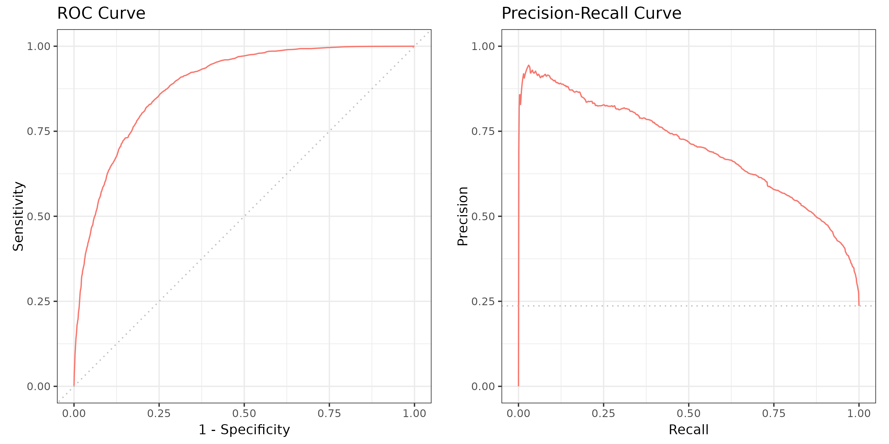

# m6APrediction

An R package for predicting N6-methyladenosine (m6A) RNA modification sites using a Random Forest classification model.

## Overview

N6-methyladenosine (m6A) is a common RNA modification involved in the regulation of RNA metabolism. Predicting potential m6A modification sites can help researchers investigate RNA modifications and their biological functions.

**m6APrediction** is an R package that predicts the probability of m6A modification at candidate RNA sites based on sequence-related and other biological features. The package uses a pre-trained Random Forest classifier and supports both single-site and multiple-site prediction.

## Features

The package provides two prediction functions and one internal helper function:

-   **dna_encoding()**: Converts DNA sequence contexts into categorical nucleotide features for model prediction. This function is used internally by the prediction functions.
-   **prediction_multiple()**: Predicts m6A modification probabilities and classification statuses for multiple candidate sites provided in a data frame.
-   **prediction_single()**: Predicts the m6A modification probability and classification status for a single candidate site.

Both prediction functions return a probability and classify candidate sites as Positive or Negative based on a user-defined threshold, which is 0.5 by default.

## Input Features

The prediction model uses the following features:

| Feature | Description |
|--------------------------|----------------------------------------------|
| gc_content | GC content of the sequence |
| RNA_type | RNA type, such as mRNA or lncRNA |
| RNA_region | RNA region, such as CDS, intron, 3'UTR or 5'UTR |
| exon_length | Log2-transformed exon length |
| distance_to_junction | Log2-transformed distance to the splice junction |
| evolutionary_conservation | Evolutionary conservation score |
| DNA_5mer | Five-nucleotide DNA sequence context |

## Installation

The package can be installed directly from GitHub using the `remotes` package.

``` r
install.packages("remotes")
remotes::install_github("amber-zhong999/m6APrediction")
```

After installation, load the package:

``` r
library(m6APrediction)
```

### Troubleshooting

If the installation fails due to a slow network connection or download timeout, try increasing the timeout:

```         
options(timeout = 600)
remotes::install_github("amber-zhong999/m6APrediction")
```

## Usage Examples

### Multiple-site Prediction

Load the pre-trained Random Forest model and example dataset:

``` r
ml_fit <- readRDS(system.file(
  "extdata", "rf_fit.rds",
  package = "m6APrediction",
  mustWork = TRUE
))

example_df <- read.csv(system.file(
  "extdata", "m6A_input_example.csv",
  package = "m6APrediction",
  mustWork = TRUE
))
```

Predict m6A modification probabilities and statuses for multiple candidate sites:

``` r
results <- prediction_multiple(
  ml_fit,
  example_df,
  positive_threshold = 0.6
)

head(results, 6)
```

The function returns the input features together with two additional columns:

-   `predicted_m6A_prob`: The predicted probability of an m6A-positive site.
-   `predicted_m6A_status`: The classification result (Positive or Negative).

### Single-site Prediction

The `prediction_single()` function predicts the m6A modification probability and classification status for one candidate site.

``` r
prediction_single(
  ml_fit,
  gc_content = 0.6,
  RNA_type = "mRNA",
  RNA_region = "CDS",
  exon_length = 12,
  distance_to_junction = 5,
  evolutionary_conservation = 0.8,
  DNA_5mer = "GGACA",
  positive_threshold = 0.5
)
```

Expected output using the supplied model:

``` text
predicted_m6A_prob   predicted_m6A_status
"0.528"               "Positive"
```

The function returns a named character vector containing the predicted probability and classification status. A site is classified as Positive when its predicted probability is strictly greater than the specified threshold.

## Model Performance

The Random Forest classification approach was evaluated using the `m6A_imbalanced.csv` dataset. The data were split into 80% for training and 20% for testing.

The held-out test set contained 9,611 samples, including 2,273 m6A-positive and 7,338 m6A-negative samples.

Model performance was assessed using Receiver Operating Characteristic (ROC) and Precision–Recall (PR) curves. The results showed:

-   **ROC-AUC: 0.885**
-   **PR-AUC: 0.700**



The ROC curve indicates good discrimination between m6A-positive and m6A-negative sites, while the PR curve provides additional insight into positive-class prediction performance in the imbalanced dataset.

*Note: The performance results were obtained from a Random Forest classifier evaluated on a held-out test set. The pre-trained model distributed with this package was fitted separately using the full dataset.*
